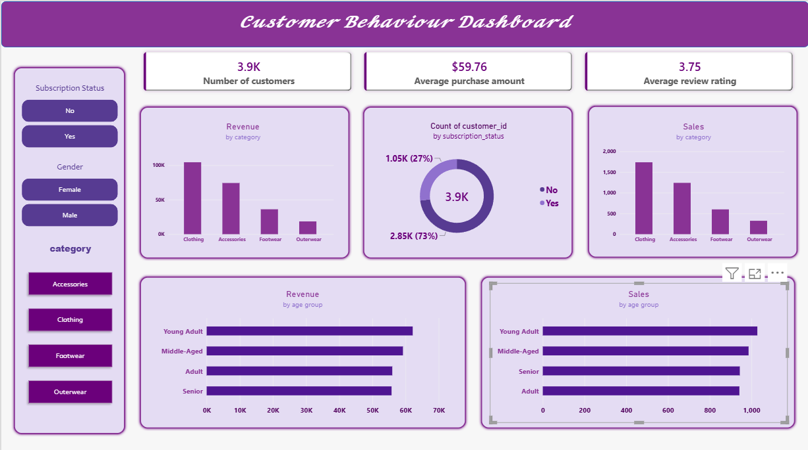

# Customer Shopping Behavior Analysis

Analysis of 3,900 retail purchases using Python, PostgreSQL and Power BI.

## What I did
- Cleaned the data in Python (filled missing ratings, renamed columns, created age groups)
- Loaded it into PostgreSQL and answered 10 business questions with SQL
- Built an interactive Power BI dashboard

## Key findings
- Male customers generated $157,890 in revenue vs $75,191 from female customers
- Young Adults are the top revenue age group ($62,143)
- Clothing is the top category by revenue
- Only 27% of customers are subscribers, and they spend about the same as non-subscribers ($59.49 vs $59.87)
- Hat, Sneakers and Coat are the most discount-dependent products

## Files
- `data/` - dataset
- `notebooks/` - Python cleaning and analysis
- `sql/` - SQL queries
- `dashboard/` - Power BI file and preview
- `reports/` - project reports

## Tools
Python, pandas, PostgreSQL, SQL, Power BI
